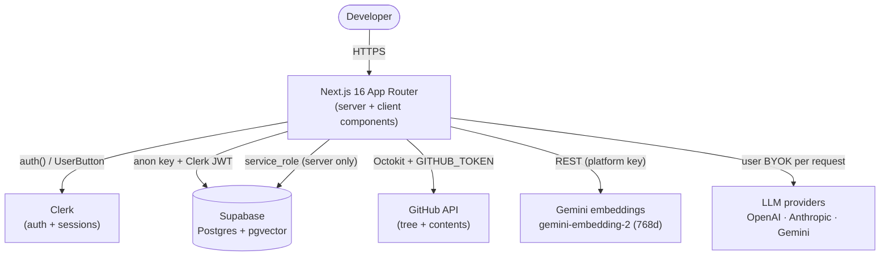
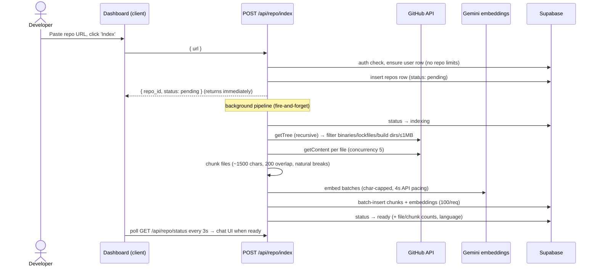
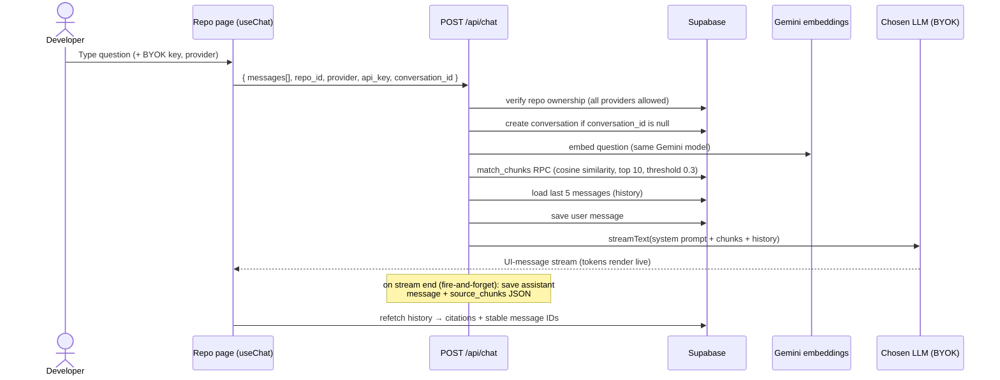
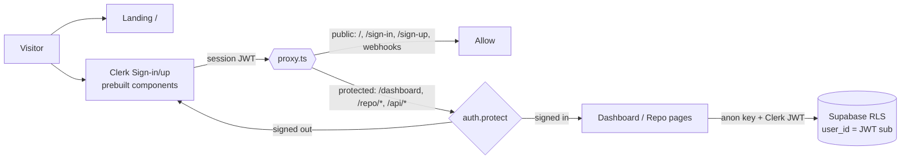

<div align="center">

# DevAsk — Understand Any Codebase in Minutes

**Paste a GitHub repo URL and have a real, multi-turn conversation with the entire codebase.**

No IDE. No setup. Just a URL — with source-file citations on every answer.


[Features](#-features) · [Architecture](#-architecture) · [How it works](#-how-it-works) · [Getting started](#-getting-started) · [API reference](#-api-reference) · [Troubleshooting](#-troubleshooting)

</div>

---

## Table of contents

- [Why DevAsk](#why-devask)
- [Features](#-features)
- [Architecture](#-architecture)
- [How it works](#-how-it-works)
  - [Repository indexing flow](#1-repository-indexing-flow)
  - [Chat / RAG flow](#2-chat--rag-flow)
  - [Authentication flow](#3-authentication-flow)
- [Tech stack](#-tech-stack)
- [Project structure](#-project-structure)
- [Database](#-database)
- [Getting started](#-getting-started)
- [Usage](#-usage)
- [API reference](#-api-reference)
- [Configuration & tuning](#-configuration--tuning)
- [Key implementation notes](#-key-implementation-notes)
- [Troubleshooting](#-troubleshooting)
- [Scripts](#-scripts)
- [Known limitations & roadmap](#-known-limitations--roadmap)

---

## Why DevAsk

Pasting a repo URL into a general LLM gets you a README summary and guesses. DevAsk instead **recursively crawls the whole file tree, chunks and embeds every file into pgvector**, and retrieves real code context per question — so answers cite the exact files they came from.

| General LLMs | DevAsk |
|---|---|
| Fetch README + a few visible files | Crawls the complete file tree via GitHub API |
| Hit context limits on large repos | Indexes everything into pgvector — no context limits |
| No memory between sessions | Persistent index + full conversation history |
| Can't access private repos | Private repos via token (per-user OAuth sync planned) |
| No source citations | Citations with similarity scores on every answer |
| Hallucinate file contents | Real semantic search per question |

## ✨ Features

- **Full RAG indexing** — every file chunked, embedded via the Gemini API, stored in pgvector.
- **Streaming chat** — token-by-token responses via the Vercel AI SDK.
- **Source citations** — each answer lists files used as context, with match % and snippet viewer.
- **Codebase file explorer** — searchable tree; click any file to view its indexed contents.
- **BYOK (Bring Your Own Key)** — OpenAI / Anthropic / Google keys are used once per request, never stored.
- **Multi-provider LLM** — GPT-4o, Claude Sonnet, Gemini Flash behind one streaming interface.
- **Private repos** — server-side GitHub token support (5,000 req/hr vs 60 anonymous).
- **Free for everything** — unlimited repos, all LLM providers, persistent history. No plans, no checkout.
- **Dark developer UI** — Tailwind v4 + shadcn, Geist fonts, violet glow aesthetic.

## 🏗️ Architecture



**Component responsibilities:**

| Layer | Lives in | Does |
|---|---|---|
| Pages | `app/` | Landing (`/`), auth (`/sign-in`, `/sign-up`), dashboard (`/dashboard`), chat (`/repo/[id]`) |
| Route guard | `proxy.ts` | Clerk protection (Next.js 16 file convention — `middleware.ts` is deprecated) |
| API routes | `app/api/` | `chat`, `repo/index`, `repo/status`, `payments/*` — all server-side, Clerk-authenticated |
| GitHub ingest | `lib/github/client.ts` | Tree crawl + content fetch, exclusion filters, token handling |
| RAG | `lib/rag/` | `chunker` (split) → `embedder` (Gemini default, Voyage opt-in) → `retriever` (pgvector search + prompt build) |
| LLM router | `lib/llm/` | One `streamChat()` over OpenAI / Anthropic / Gemini adapters (BYOK) |
| Database | `lib/supabase/` | Browser client (RLS-bound), service client (server-only), schema + migrations |
| UI | `components/` | Chat, file explorer, provider selector, repo cards, shadcn primitives |
| Contract | `types/index.ts` | Single source of truth: entities, API shapes, default models |

## 🔄 How it works

### 1. Repository indexing flow



> ⚠️ Indexing runs **in-request, fire-and-forget** (no job queue). Large repos on serverless hosts risk function timeouts — see [Known limitations](#-known-limitations--roadmap).

### 2. Chat / RAG flow



Key details:

- The client sends the AI SDK transport envelope (`messages[]` + top-level `repo_id`/`provider`/`api_key`/`conversation_id`); the server also accepts a legacy top-level `message` string.
- The transport is **static** — per-request fields travel via `sendMessage(text, { body })`, because `useChat` captures the transport instance once on first render (a `body()` closure over state would send stale values forever).
- The server returns the stream with an `x-conversation-id` header so the client learns newly created conversation IDs.

### 3. Authentication flow



- Server components/layouts call `auth()`; API routes reject unauthenticated callers (browser hits get a Clerk redirect via `auth.protect()` in `proxy.ts`).
- The browser Supabase client attaches the Clerk session JWT to every request; Supabase validates it via the Clerk JWKS configured under **Authentication → Third-Party Auth**, and RLS policies isolate each user's rows.
- Webhook routes are explicitly public and authenticate via provider signatures instead.

## 🧰 Tech stack

| Concern | Choice | Notes |
|---|---|---|
| Framework | Next.js 16.2.9 (App Router, Turbopack) | `proxy.ts` replaces `middleware.ts`; `force-dynamic` on app pages |
| UI | React 19, Tailwind CSS v4, shadcn (radix-nova), Lucide | Dark mode default, Geist fonts |
| Auth | Clerk `@clerk/nextjs` v7 | Prebuilt components + `auth()` + third-party JWT for Supabase |
| Database | Supabase Postgres + pgvector | 5 tables, RLS everywhere, `match_chunks` RPC |
| Embeddings | Gemini `gemini-embedding-2`, 768 dims (AI Studio REST) | Platform key, free-tier paced; Voyage API remains opt-in |
| Chat LLM | Vercel AI SDK (`ai` + `@ai-sdk/*`) | BYOK: GPT-4o, Claude Sonnet 4.6, Gemini 3.8 Flash |
| GitHub | Octokit | Token-authenticated crawl, 401/403/429 abort loudly |
| State (client) | TanStack Query | Dashboard server-state; chat via `useChat` |
| Markdown/code | react-markdown + remark-gfm, shiki | `shiki` externalized via `serverExternalPackages` |

## 📁 Project structure

```text
DevAsk/
├── app/                          # Next.js App Router
│   ├── page.tsx                  # Landing page (public, marketing + pricing)
│   ├── layout.tsx                # Root: ClerkProvider, Geist fonts, dark mode
│   ├── globals.css               # Tailwind v4 theme, custom tokens & chat prose
│   ├── (auth)/sign-in|sign-up/   # Clerk prebuilt components (catch-all routes)
│   ├── dashboard/                # Authed repo grid: list/add/reindex/delete
│   ├── repo/[id]/                # Authed chat: layout guards ownership, page hosts chat
│   └── api/
│       ├── chat/route.ts         # RAG chat (validate → retrieve → stream → persist)
│       ├── repo/index/route.ts   # Start indexing (returns pending, pipelines async)
│       └── repo/status/route.ts  # Poll index status + counts (client polls 3s)
├── components/
│   ├── chat/                     # chat-input, message-list, message-bubble, citations
│   ├── file-explorer/            # Flat paths → nested tree + search
│   ├── provider-selector/        # LLM picker + BYOK key input
│   ├── repo-card/                # Status badge, metadata, reindex/delete/chat actions
│   ├── providers.tsx             # TanStack Query provider (dashboard/repo only)
│   └── ui/                       # shadcn primitives
├── lib/
│   ├── github/client.ts          # Octokit: parse URL, tree+content fetch, lang detect
│   ├── rag/
│   │   ├── chunker.ts            # ~1500-char chunks, 200 overlap, natural breaks
│   │   ├── embedder.ts           # Provider dispatch: gemini (default) vs voyage
│   │   ├── gemini.ts             # AI Studio embeddings (paced, needs key)
│   │   ├── voyage.ts             # Voyage API (opt-in, paced, needs key)
│   │   └── retriever.ts          # match_chunks RPC + system-prompt builder
│   ├── llm/
│   │   ├── index.ts              # streamChat router + provider display names
│   │   ├── extract-user-text.ts  # Latest user text from transport messages[]
│   │   └── providers/            # openai.ts, anthropic.ts, gemini.ts (BYOK adapters)
│   ├── supabase/
│   │   ├── client.ts             # Browser singleton (RLS-bound, Clerk JWT injected)
│   │   ├── service.ts            # Service-role client (SERVER ONLY, bypasses RLS)
│   │   ├── schema.sql            # Full schema: tables, indexes, RLS, RPC
│   │   ├── migration-001-*.sql   # 1536/768 → 1024 (Voyage era)
│   │   ├── migration-002-*.sql   # 1024 → 384 (local bge-small era)
│   │   └── migration-003-*.sql   # 384 → 768 (Gemini era)
│   └── utils.ts                  # cn() (clsx + tailwind-merge)
├── types/index.ts                # Shared contract: entities, API shapes, plans, models
├── proxy.ts                      # Clerk route guard (protected vs public matchers)
├── public/                       # Static assets
├── .env.example                  # All env vars, documented (copy to .env.local)
├── components.json               # shadcn config
├── next.config.ts                # shiki externalized, avatar image hosts
└── package.json                  # Scripts: dev / build / start / lint
```

## 🗄️ Database

Defined in [`lib/supabase/schema.sql`](lib/supabase/schema.sql) — run it once in the Supabase SQL Editor. Requires the **pgvector** extension.

| Table | Purpose | Key columns |
|---|---|---|
| `users` | Clerk-linked profile | `id` (Clerk ID), `github_token` (legacy subscription columns unused) |
| `repos` | Indexed repositories | `id` (uuid), `user_id`, `url/owner/name`, `index_status` (`pending\|indexing\|ready\|failed`), `metadata` (jsonb) |
| `chunks` | RAG vector store | `repo_id` (cascade delete), `file_path`, `content`, `embedding vector(768)` |
| `conversations` | Chat sessions | `repo_id`, `user_id`, `is_public` (shareable links) |
| `messages` | Chat history | `conversation_id` (cascade), `role`, `content`, `source_chunks` (jsonb) |

- **Vector search:** `match_chunks(query_embedding, repo_id, threshold, count)` RPC does cosine-similarity search (`<=>`) scoped per repo; an IVFFlat index accelerates it.
- **RLS:** enabled on all tables; policies bind rows to `auth.jwt() ->> 'sub'` (the Clerk user ID) — plus public-read for shared conversations. Service-role clients bypass RLS for indexing, chat, and webhooks.
- **Embeddings are server-side only** — never selected by browser queries.

---

## 🚀 Getting started

### Prerequisites

- **Node.js 20.9+** (v20.19+ verified; v22+ silences a transitive engine warning)
- Accounts/keys: **Clerk**, **Supabase**, **Google AI Studio** (free tier, no card — covers embeddings and Gemini chat), **GitHub** (PAT)

### 1. Install

```bash
git clone <repo-url> && cd DevAsk
npm install
cp .env.example .env.local   # then fill in the values below (once only!)
```

> ⚠️ Copy `.env.example` **once**. Re-running `cp` overwrites your filled-in `.env.local` with blanks — if your keys vanish, that's what happened.

> If `npm ci` complains the lockfile is out of sync, use `npm install` (it re-syncs `package-lock.json`).

### 2. Environment variables

All 11 live in [`.env.example`](.env.example) with comments:

| Variable | Where to get it | Used for |
|---|---|---|
| `NEXT_PUBLIC_CLERK_PUBLISHABLE_KEY` | Clerk dashboard → API Keys | Browser auth |
| `CLERK_SECRET_KEY` | Clerk dashboard → API Keys | Server `auth()` |
| `NEXT_PUBLIC_SUPABASE_URL` | Supabase → Settings → API | Both clients |
| `NEXT_PUBLIC_SUPABASE_ANON_KEY` | Supabase → Settings → API | Browser client (RLS-bound) |
| `SUPABASE_SERVICE_ROLE_KEY` | Supabase → Settings → API | Server client (**secret**, bypasses RLS) |
| `EMBEDDING_PROVIDER` | — | `gemini` (default, needs key below) or `voyage` (opt-in comparison) |
| `RETRIEVAL_THRESHOLD` | — | Cosine cutoff (default 0.3) |
| `GEMINI_EMBEDDING_API_KEY` | [Google AI Studio](https://aistudio.google.com) → Get API key | Required (default provider); can be the same key as Gemini chat |
| `GEMINI_EMBEDDING_MODEL` | — | Optional override (default `gemini-embedding-2`); must accept 768-dim output |
| `VOYAGE_API_KEY` | [Voyage dashboard](https://dashboard.voyageai.com) → API keys | Only when `EMBEDDING_PROVIDER=voyage`; never called in gemini mode |
| `GITHUB_TOKEN` | GitHub → Settings → Personal access tokens (no scopes needed for public repos) | Indexing at 5,000 req/hr |

### 3. Supabase setup (3 steps — all required)

1. **Schema:** in Supabase → SQL Editor, run [`lib/supabase/schema.sql`](lib/supabase/schema.sql) once (creates tables, RLS, `match_chunks` RPC — 768-dim for the default Gemini provider).
   - Upgrading from an older checkout? Run [`lib/supabase/migration-003-gemini-768.sql`](lib/supabase/migration-003-gemini-768.sql) — it resizes `chunks.embedding` to `vector(768)`, replaces the RPC, deletes incompatible old vectors, and marks old repos as failed with a re-index note. Then delete + re-add each repo from the dashboard. (Migration-001/002 cover the earlier Voyage → local steps, kept for history.)
2. **Clerk trust:** in Supabase → **Authentication → Third-Party Auth**, enable the **Clerk** provider and set your Clerk domain (e.g. `https://<instance>.clerk.accounts.dev`). Without this, every browser read is denied by RLS (dashboard looks empty, repo pages hang on loading).
3. **pgvector:** enabled by the schema script (`create extension if not exists vector`) — no manual step.

### 4. Clerk setup

- Create an application, copy both API keys into `.env.local`.
- No custom JWT template needed — the native Supabase third-party auth validates standard Clerk session tokens via JWKS.

### 5. Run

```bash
npm run dev      # → http://localhost:3000
```

Sign up, paste a repo URL on the dashboard, wait for indexing, then chat.

## 📖 Usage

| Action | How |
|---|---|
| Index a repo | Dashboard → **Add Repository** → paste `https://github.com/owner/name` |
| Track progress | Repo page polls `/api/repo/status` every 3s until `ready` |
| Chat | Open the repo → pick provider → enter BYOK key → ask (Enter to send) |
| View sources | Click any `[n] filename` citation chip under an answer |
| Browse files | Left explorer → search / click any file for full contents |
| Starter prompts | Empty chat shows 4 suggested architecture questions |
| Re-index | Delete the repo card first, then re-add (avoids duplicate rows) |

Everything is free with no limits: unlimited repositories, all LLM providers, persistent history.

## 🔌 API reference

All routes except webhooks require a Clerk session (browsers are redirected to sign-in; direct callers get 401/redirect).

| Method & path | Auth | Body / query | Returns |
|---|---|---|---|
| `POST /api/repo/index` | user | `{ url: "https://github.com/o/n" }` | `{ repo_id, status: "pending" }` |
| `GET /api/repo/status?repo_id=` | owner | query param | `{ index_status, file_count, chunk_count, metadata }` |
| `POST /api/chat` | owner | `{ messages[] }` (transport) **or** `{ message }` (direct), `repo_id`, `provider`, `api_key`, `conversation_id?` | UI-message stream + `x-conversation-id` header |

**Chat request notes:**

- `provider`: `anthropic` | `openai` | `gemini`; `api_key` is BYOK (never persisted); `message`/`messages` carry the question (see [transport note](#-key-implementation-notes)).
- `400 { error }` names exactly which required fields are missing, and rejects unknown providers.
- `404` for repos you don't own.
- The stream is `toUIMessageStreamResponse()`; the assistant reply is persisted with `source_chunks` when streaming completes.

---

## ⚙️ Configuration & tuning

All knobs are constants near the top of their files — no config service:

| Knob | File | Default | Effect |
|---|---|---|---|
| Chunk size / overlap | `lib/rag/chunker.ts` | 1500 / 200 chars (~470/50 code-tokens) | Sized for retrieval granularity; overlap preserves boundary context |
| Embedding batch | `lib/rag/gemini.ts` (`GEMINI_MAX_BATCH_CHARS` / `GEMINI_MAX_BATCH_COUNT`) | ~8K chars, ≤16 texts/batch | Sized for the AI Studio free tier (30K TPM) |
| Retrieval top-K / threshold | `lib/rag/retriever.ts` (`RETRIEVAL_THRESHOLD`) | 10 chunks, 0.3 cosine | Threshold was Voyage-tuned — re-evaluate for Gemini; raise K for broad questions |
| Gemini pacing | `lib/rag/gemini.ts` | 4s spacing, 8 retries, honors `Retry-After` | Default path; tune via `GEMINI_REQUEST_INTERVAL_MS` |
| Voyage pacing (opt-in path) | `lib/rag/voyage.ts` | AIMD delay, 8 retries, honors `Retry-After` | Only when `EMBEDDING_PROVIDER=voyage` |
| History window | `app/api/chat/route.ts` | Last 5 messages | More = better follow-ups, higher per-message cost |
| GitHub fetch concurrency | `lib/github/client.ts` | 5 parallel | Higher = faster indexing, more rate-limit pressure |
| Excluded paths | `lib/github/client.ts` | `node_modules`, `.git`, `dist`, `build`, binaries, lockfiles… | Extend to skip generated code |
| Max file size | `lib/github/client.ts` | 1 MB | Larger files are skipped silently |
| Default models | `types/index.ts` (`DEFAULT_MODELS`) | `gpt-4o`, `claude-sonnet-4-6`, `gemini-3.8-flash` | Overridable per request via `model` |

**Embedding model choice:** Google `gemini-embedding-2` (768 dims, truncated from native 3072) via the AI Studio REST API — needs the platform `GEMINI_EMBEDDING_API_KEY` (free tier, same key as Gemini chat). Batching + 4s pacing keep usage inside the free tier (100 RPM / 30K TPM / 1K RPD). Run `npm run benchmark:embeddings` for a live smoke test (5 chunks, dimension + sanity assertions).

Embedding notes:

- Indexing and chat queries share one key, so they go through one serialized queue; chat queries outrank indexing batches and wait behind at most one in-flight request.
- Documents embed with `RETRIEVAL_DOCUMENT`, questions with `RETRIEVAL_QUERY`; both live in the same 768-d space.
- Every ready index is stamped with `embedding_model`/`embedding_dimensions` in `repos.metadata`; chat returns 409 on a stamped index built by another provider instead of mixing vector spaces.
- To compare against Voyage: set `EMBEDDING_PROVIDER=voyage` + `VOYAGE_API_KEY` (needs the 1024-dim schema — migration-001 era) and re-index. Never mix providers without re-indexing.
- Switching models later requires resizing `chunks.embedding`, recreating the IVFFlat index + RPC, and re-indexing everything (see migration-003 for the pattern).

## 🧠 Key implementation notes

Read this before changing code — these are the non-obvious decisions and traps:

1. **Next.js 16 is not classic Next.js.** Route guards live in **`proxy.ts`** (the `middleware.ts` convention is deprecated). Per repo rules, read the relevant guide in `node_modules/next/dist/docs/` before writing framework code, and heed deprecation notices.
2. **Chat transport must stay static.** `useChat` instantiates its `Chat` (capturing your transport) exactly once on first render — a `body()` closure over React state sends **first-render values forever** (`api_key: ''` → 400). Request fields travel via `sendMessage(text, { body })` per request. Never move them back into the transport constructor.
3. **BYOK keys are never stored.** The key rides the request body, is used for one `streamChat()` call, and is discarded. The only platform-owned keys are the embedding keys (`VOYAGE_API_KEY` / `GEMINI_EMBEDDING_API_KEY`), selected by `EMBEDDING_PROVIDER`.
4. **Two Supabase clients, never mixed:** `lib/supabase/client.ts` (browser, anon key, RLS-bound, Clerk JWT injected) vs `lib/supabase/service.ts` (server-only service role, bypasses RLS). Importing the service client in a client component would leak it to the browser.
5. **Indexing runs in `after()`, not bare fire-and-forget.** The API returns `pending` immediately and pipelines after the response; the client polls. A floating promise would freeze the instant the response ends on serverless (Vercel) — `after()` extends the invocation up to `maxDuration = 60` (the Hobby ceiling; raise toward 300 on Pro). There is no queue — a repo that outlives the cap stalls at `indexing` with partial chunks; delete it and index on a host without the 60s cap (or raise `maxDuration` on Pro).
6. **Conversation continuity** relies on the `x-conversation-id` response header: the client sends `conversation_id: null` once, the server creates the conversation and returns its ID in the header, and subsequent sends reuse it.
7. **Reindex duplicates.** The dashboard "re-index" button inserts a *new* repo row rather than refreshing in place — delete first, then re-add.
8. **`users.github_token` is never synced.** The column exists for per-user GitHub OAuth, but no code writes it; indexing authenticates via the server-side `GITHUB_TOKEN` env var. Per-user private-repo OAuth is the planned production follow-up.
9. **Embeddings are provider-dispatched, Gemini by default.** `lib/rag/embedder.ts` routes to `./gemini` (API) or `./voyage` (API) per `EMBEDDING_PROVIDER`. Never add a silent cross-provider fallback — different providers mean different vector spaces. The 768/1024 dimension must always match the DB column; the model stamps every index so chat can refuse mismatches (409).

## 🩺 Troubleshooting

| Symptom | Cause | Fix |
|---|---|---|
| GitHub `403` during indexing | Anonymous API quota (60/hr) exhausted — no token | Set `GITHUB_TOKEN` in `.env.local` and restart dev (5,000/hr) |
| `different vector dimensions …` (chat) | Index built by the other embedding provider | Delete + re-add the repo; check the column width matches the provider (768 gemini / 1024 voyage) |
| `expected 768 dimensions, not …` (indexing) | DB column predates the Gemini migration, or provider flipped without re-indexing | Run `lib/supabase/migration-003-gemini-768.sql`, delete + re-add repos |
| `The local embedding provider was removed` (indexing) | `.env.local` still has `EMBEDDING_PROVIDER=local` from an older checkout | Set `EMBEDDING_PROVIDER=gemini` + `GEMINI_EMBEDDING_API_KEY`, restart dev |
| Repo page stuck on "Loading repository" | Supabase doesn't trust Clerk JWTs → RLS denies all browser reads | Supabase → Authentication → Third-Party Auth → enable Clerk + set domain |
| Dashboard shows no repos (but indexing works) | Same RLS cause as above | Same fix; a banner now surfaces query errors |
| Chat 400 `Missing required fields: …` | A field didn't reach the server (empty key, regressed transport, …) | The error names the field; check key input and the transport note above |
| Chat sends but nothing streams, no provider usage | Request rejected before the LLM (see banner) | Read the banner error text; check provider key |
| `Multiple GoTrueClient instances` warning | More than one browser Supabase client constructed | Should not happen (singleton); report if you see it |
| `npm ci` fails (lockfile out of sync) | Committed lockfile drifted from `package.json` | Use `npm install` to re-sync |
| Slow indexing (large repos) | Gemini free tier pacing: 4s between requests | Expected on free tier; ~15 chunks/min on big repos |
| Index stuck at `indexing`, Chunks 0, on Vercel | Background work frozen at response end (pre-`after()` code) | Pull latest (indexing runs in `after()`), redeploy, delete + re-add the repo |
| Index stalls with partial chunks on Vercel | Repo outlived the 60s Hobby `maxDuration` cap | Delete the repo; raise `maxDuration` on Pro, or host on Railway/Render/VPS |
| `commander EBADENGINE` warning on install | Transitive dep wants Node ≥22; repo runs on Node 20 | Harmless — ignore, or use Node 22 |

## 📜 Scripts

| Command | What it does |
|---|---|
| `npm run dev` | Start Turbopack dev server → http://localhost:3000 |
| `npm run build` | Production build |
| `npm run start` | Serve a production build |
| `npm run lint` | ESLint (Next core-web-vitals + TypeScript) |
| `npm test` | node:test embedding unit tests (offline, fast) |
| `npm run benchmark:embeddings` | Live embedding smoke test (dims, throughput, sanity) |
| `npx tsc --noEmit` | Full typecheck (must stay clean) |

Conventions: `tsc` must be clean; keep every file you touch at **zero ESLint errors** (the repo-wide run still has pre-existing findings in untouched files — don't add new ones). Types live in `types/index.ts`; path alias is `@/*`.

## 🚧 Known limitations & roadmap

- [ ] **Per-user GitHub OAuth sync** — populate `users.github_token` from Clerk so private repos work per user (currently server `GITHUB_TOKEN` only).
- [ ] **Durable indexing pipeline** — move off fire-and-forget to a queue (Inngest/Trigger.dev/pg-boss) with resume + real progress.
- [ ] **Reindex in place** — update the existing row instead of inserting a duplicate.
- [ ] **CI** — `node:test` suite exists (`tests/embedder.test.ts`, via `npm test`); GitHub Actions wiring still wanted.
- [ ] **Share/export UI** — `is_public` exists, but no share-link or export UI is built.
- [ ] **Auto summaries** — `metadata.summary`/`architecture` fields exist but nothing generates them yet.

---

<div align="center">

**Built for developers who want deep understanding, not surface-level summaries.**
Paste a URL. Ask anything. Verify everything.

</div>

